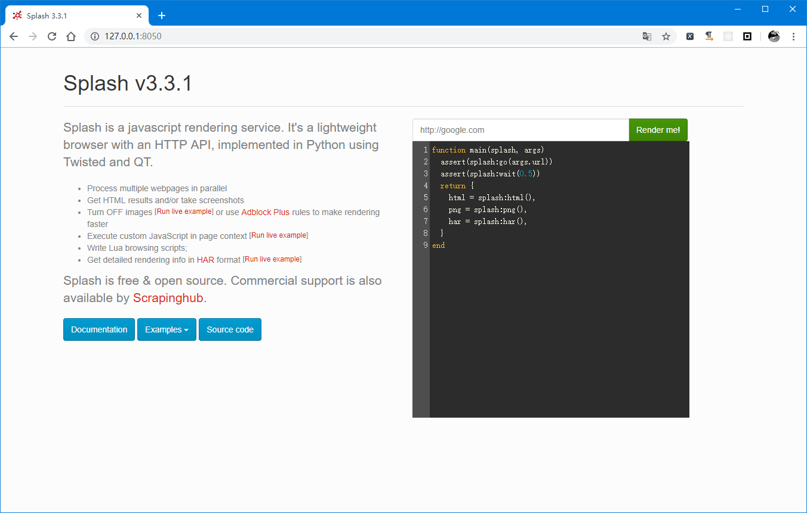

#### some spider about scrapy

###### before start

environment: python3

pip install -r requirement

    
###### file  

- weather (orign: http://lishi.tianqi.com/)
    - web abstract: Chinese city's Historical weather
    - save all city weather data to MongoDB
        - `city_name` city name
        - `date` date
        - `ht` Highest temperature
        - `lt` Lowest temperature
        - `weather`
        - `wind_dir` Wind direction
        

- biquge ( orign: https://www.biqugex.com/)
    - web abstract: A free Chinese novel website.
    - save all novel to MongoDB
        
        `db.getCollection('book').distinct('book_name')` to see the name of we get and you can use the count Attribute of this to see how many books we get or getting.
        
        `db.getCollection('book').aggregate([{$group: {_id: '$book_name',count: {$sum: 1}}},{$sort: {'count': -1}}])` to see the number of chapters in each book
        
        - `book_name` the name of the novel
        - `chapter_name` the chapter name of every chapter
        - `content` the content of the chapter
        
- biqugeDistributed
    - Distributed build a spider of biquge
    

###### start

`python start.py`

`'scrapy', 'crawl', 'download'` the third `download` is the name of the spider 

if you want to save a Specific type file run like this `scrapy crawl -t csv -o data.csv`

You can choose the following types
    
- json
- jsonlines
- jl
- csv - settings.py `FEED_EXPORT_ENCODING = "gb18030"`
- xml
- marsha1
- pickle

###### settings.py

`DOWNLOAD_DELAY = 1` Visit the page every 1 seconds

- open custom cookies
    - settings.py
    ```python
  COOKIES_ENABLED = False
    ```
    - spider_file
    ```python
  custom_settings = {
    'DEFAULT_REQUEST_HEADERS': {}
  }
    ```

- save mongo
    
    ```python
  mongo = {
    # MONGODB HOST
    "MONGODB_HOST": "127.0.0.1",
    # MONGODB PORT
    "MONGODB_PORT": 27018,
    # DB NAME
    "MONGODB_DBNAME": "spider"
  }

  ITEM_PIPELINES = {
    'scrapy_spider.pipelines.SpiderPipeline': 300,
  }
    ```
    
- use splash
    - you should install the Docker-Desktop or Docker-Toolbox and run command as follows
    
        1、get splash image `docker pull scrapinghub/splash`
        
        2、run splash `docker run -p 8050:8050 scrapinghub/splash`
        
        you can see the result about splash in `http://127.0.0.1:8050/` or `http://192.168.99.100:8050/`
        
        image as follows:
        

- distributed

    - settings.py
     
        ```python
      REDIS_HOST = '192.168.1.44'
        
      REDIS_PORT = 6379
        
      DUPEFILTER_CLASS = "scrapy_redis.dupefilter.RFPDupeFilter"
      SCHEDULER = "scrapy_redis.scheduler.Scheduler"
      SCHEDULER_PERSIST = True
        ```
    
    - spider file
    
        ```python
      redis_key = 'biquge:start_urls'
        ```
    - tips
    
        we need to client reids run command like this `lpush + redis_key + start_url`
        
        means: Put the start_url into redis SCHEDULER